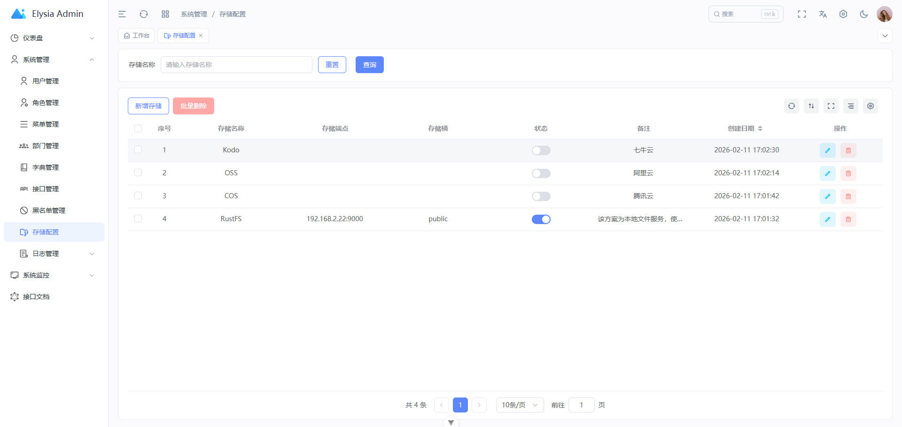

<p align="center">
  <a href="https://elysia-admin.top">
    <picture>
      <source media="(prefers-color-scheme: dark)" srcset="https://elysia-admin.top/big-logo.webp">
      
    </picture>
    <h1 align="center">Elysia Admin</h1>
  </a>
</p>

<p align="center">
  =1.2.21&color=orange" alt="Bun Version">
  =22.0.0&color=blue" alt="Node.js Version">
  =16&color=blue" alt="PostgreSQL">
  =6&color=red" alt="Redis">
  
</p>

一个基于 [ElysiaJS](https://elysiajs.com/) + [Art Design Pro](https://www.artd.pro/docs/zh/) 的现代化全栈后台管理系统。

- 官网：<https://elysia-admin.top>
- 演示：<https://demo.elysia-admin.top/admin>（账号：`admin` / 密码：`123456`）
- Gitee：<https://gitee.com/nian-qian/elysia-admin>
- GitHub：<https://github.com/meishanlaoyao/elysia-admin>



## 简介

`Elysia Admin` 是一套基于 `ElysiaJS` 后端与 `Vue 3` 前端的全栈解决方案，致力于解决国内 `Node.js` 开发者在构建后台系统时的痛点。

核心亮点：彻底告别繁琐的链式调用，引入类似 `Vue Router` 的配置化路由写法，让代码结构清晰直观，充分释放 `Bun` 运行时的强大性能潜力。

## 性能表现

生产环境下后端服务资源占用：**内存 ~80MB，毫秒级启动**。

| 框架 | 请求/秒 (RPS) |
|------|--------------|
| **Elysia.js + Bun** | ~2,454,631 |
| Gin (Go) | ~676,019 |
| Spring Boot (Java) | ~506,087 |

> 数据来源：TechEmpower 基准测试第 22 轮（2023-10-17）PlainText 结果，实际性能因业务复杂度而异。

## 技术栈

**后端**：Bun + ElysiaJS + PostgreSQL + Redis + Drizzle ORM + BullMQ + Nodemailer

**前端**：Vue 3 + TypeScript + Vite + Element Plus + Pinia + Tailwind CSS

## 内置功能

### 系统管理
- 用户管理、角色管理、菜单管理、部门管理
- 字典管理、API 管理、存储管理、IP 黑名单
- 通知公告、版本管理、个人中心
- 站点部署：Nginx 站点配置预览与 ACME 证书管理

### 系统监控
- 在线用户、定时任务、缓存监控
- 队列监控（BullMQ 队列与任务详情）
- 登录日志、操作日志

### 支付与业务
- 统一适配层 `Pay(channel, platform)` 支持支付宝、微信支付、PayPal 多渠道多终端
- 内置下单、查询、退款、异步回调验签，业务侧无需处理各渠道差异
- 商户管理（渠道配置）、订单管理、支付/退款流水
- 支付调试台（分阶段查看请求与结果）

### 认证与安全
- JWT 双 Token 认证（登录/注册/忘记密码/重置密码）
- RBAC 权限控制 + 动态路由
- IP 限流 + 接口熔断 + IP 黑名单
- 请求/响应加密（RSA + AES-GCM）：支持关闭、仅加密指定接口、或除指定接口外全部加密，按请求方法 + 路径配置，见下文「配置说明」

### 开发效率
- 模块脚手架：`create:module` / `create:page` 一键生成 CRUD 后端与前端页面
- 根目录一键安装 / 打包 / 开发，支持通过 `workspace.json` 托管新增项目
- 内置 AI 开发规范（`.ai/` 及各 AI IDE 规则）

### 界面
- 多主题（亮色/暗色）+ 多语言（中/英）
- 响应式布局
- 数据看板（控制台 / 分析页 / 电商页）

## 快速开始

### 前置依赖

- [Node.js >= 22.0.0](https://nodejs.org/)
- [Bun >= 1.2.21](https://bun.sh/)
- [PostgreSQL >= 16](https://www.postgresql.org/)
- [Redis >= 6](https://redis.io/)

### 克隆项目

```bash
# Gitee
git clone https://gitee.com/nian-qian/elysia-admin.git

# GitHub
git clone https://github.com/meishanlaoyao/elysia-admin.git
```

### 启动后端

```bash
cd server

# 安装依赖
bun install

# 修改 src/config/development.yaml 中的数据库配置

# 推送数据库结构
bun db:push

# 启动开发服务器
bun dev
```

后端服务运行在 `http://localhost:3000`，API 文档访问 `http://localhost:3000/api/openapi`。

### 启动前端

```bash
cd admin

# 安装依赖
pnpm install

# 启动开发服务器
pnpm dev
```

前端服务自动打开浏览器，默认访问 `http://localhost:3006`。

### 一键安装 / 打包 / 开发

在仓库根目录按 `workspace.json` 清单统一管理多个项目（无需额外依赖，需已安装 Node、Bun、pnpm）：

```bash
bun run install:all            # 安装所有项目依赖（lockfile 未变化时自动跳过）
bun run build:all              # 打包所有项目
bun run dev:all                # 同时启动所有项目的开发服务
bun run install:all -- admin   # 只处理指定项目
bun run install:all -- --force # 强制重装
bun run list                   # 查看清单
```

新增项目：在 `workspace.json` 的 `projects` 中加一项（`name` / `dir` / `install` / `build` / `dev`，`enabled: false` 可暂时跳过）。

## 项目结构

```
elysia-admin/
├── admin/            # 前端项目（Vue 3）
├── server/           # 后端项目（ElysiaJS）
├── scripts/          # 多项目托管脚本（workspace.mjs）
├── workspace.json    # 项目清单（一键安装 / 打包 / 开发）
└── package.json      # 根快捷命令（无依赖）
```

## 开发目录建议

日常做业务开发，**只需保留 `admin/` 与 `server/`** 即可跑通前后端。其余目录按工具链选用，不用可删。

### 必须保留

| 目录 / 文件 | 说明 |
|-------------|------|
| `admin/` | 前端源码与配置 |
| `server/` | 后端源码、数据库 Schema、配置 |
| `workspace.json`、`scripts/`、根 `package.json` | 一键安装 / 打包 / 开发入口（删除后需分别进入各项目操作） |
| `README.md`、`LICENSE` | 项目说明与许可证 |

### 按需保留（不用可删）

| 目录 / 文件 | 适用场景 | 删除影响 |
|-------------|----------|----------|
| `.vscode/` | VS Code 一键任务、调试配置 | 不影响运行，仅失去 IDE 预设 |
| `AGENTS.md` | Codex 及通用 AI 项目指引 | Codex 分层指令会缺失 |
| `.ai/` | 任意 AI 辅助开发（模块 SOP、代码模板） | 不影响运行，AI 生成质量可能下降 |
| `.cursor/` | Cursor 规则与 Skill | 仅 Cursor 失效 |
| `.qoder/` | Qoder 规则与 Skill | 仅 Qoder 失效 |
| `.claude/` | Claude Code 规则 | 仅 Claude Code 失效 |
| `.codex/` | OpenAI Codex 说明 | 仅 Codex 失效 |
| `.kiro/` | Kiro Steering | 仅 Kiro 失效 |
| `.trae/` | Trae 规则 | 仅 Trae 失效 |

> 多个 AI IDE 配置语义一致，**只保留你正在用的那一套**即可；`.ai/` 是各工具共用的规范文档，用 AI 写模块时建议留着。

### 可安全删除（会自动重新生成）

| 路径 | 说明 |
|------|------|
| `admin/node_modules/`、`server/node_modules/` | 依赖目录，`bun run install:all` 可恢复 |
| `admin/dist/` | 前端构建产物，`pnpm build` 生成 |
| `server/dist/` | 后端构建产物，`bun run build` 生成 |
| `server/database/drizzle/` | Drizzle 迁移快照，`bun db:push` 等命令可再生成 |
| `server/logs/` | 运行日志 |

**精简示例**（只做业务、用 Cursor 开发）：

```
elysia-admin/
├── admin/
├── server/
├── .ai/              # 可选，AI 写模块时推荐
├── .cursor/          # 可选，Cursor 用户保留
├── scripts/
├── workspace.json
├── package.json
├── AGENTS.md         # 可选
├── README.md
└── LICENSE
```

## 文件存储

支持阿里云 OSS、腾讯云 COS、七牛云、MinIO、RustFS 等 S3 兼容存储。

推荐本地开发使用 RustFS：

```bash
docker run -d --name rustfs_container --user root \
  -p 9000:9000 -p 9001:9001 \
  -v /mnt/rustfs/data:/data \
  -e RUSTFS_ACCESS_KEY=rustfsadmin \
  -e RUSTFS_SECRET_KEY=rustfsadmin \
  rustfs/rustfs:latest \
  --address :9000 --console-enable \
  --access-key rustfsadmin --secret-key rustfsadmin /data
```

控制台：`http://localhost:9001`

## 配置说明

### 后端（server/src/config/）

```yaml
# development.yaml / production.yaml
app:
  port: 3000
  prefix: "/api"

jwt:
  accessToken:
    expiresIn: "15m"
    secret: "your_access_secret"
  refreshToken:
    expiresIn: "7d"
    secret: "your_refresh_secret"

redis:
  host: "localhost"
  port: 6379
  password: ""
  db: 0

pg:
  host: "localhost"
  port: 5432
  username: "postgres"
  password: "your_password"
  database: "elysia-admin"

# 请求/响应加解密（RSA + AES-GCM）
crypto:
  mode: "off"        # off 不开启 | include 只加密 routes | exclude 除 routes 外全部加密
  routes: []         # 逐条写: - { method: "POST", url: "/api/auth/login" }（method 须大写，url 中 * 匹配任意字符）
  privateKey: ""     # 用 bun run gen:crypto-keys [production] 生成
  publicKey: ""
```

> 完整配置项（smtp、guard、orders、log 等）见 `development.yaml`。启用加密后前端无需配置，会自动从 `GET /api/crypto/public-key` 获取模式、接口列表和公钥；需加密的接口收到明文会返回 400。

### 前端（admin/）

```env
# .env.development
VITE_API_URL=http://localhost:3000          # API 请求基础地址
VITE_API_PROXY_URL=http://localhost:3000    # Vite 开发代理目标

# .env.production
VITE_API_URL=https://your-api-domain.com
```

## 部署

> 前后端一起打包可在根目录执行 `bun run build:all`；以下为各项目单独部署步骤。

### PM2 部署（推荐）

```bash
cd server

# 构建
bun run build

# 启动（主进程 + Worker 进程）
pm2 start dist/ecosystem.config.cjs
```

### Docker 部署

```bash
cd server
bun docker:build
# 运行建议加 --init，配置挂载至 /app/dist/production.yaml
docker run -d --name elysia-admin --init -p 3000:3000 \
  -v /path/to/production.yaml:/app/dist/production.yaml \
  hnq1/elysia-admin:latest
```

### 前端部署

```bash
cd admin
pnpm build
# dist 目录部署到 Nginx / Vercel / Netlify 等
```

## 源码分支

| 分支 | 描述 | 状态 |
|------|------|------|
| `master` | 主分支 | 已完成 |

## 许可证

[MIT License](LICENSE)

---

⭐ 如果这个项目对你有帮助，欢迎 Star 支持！